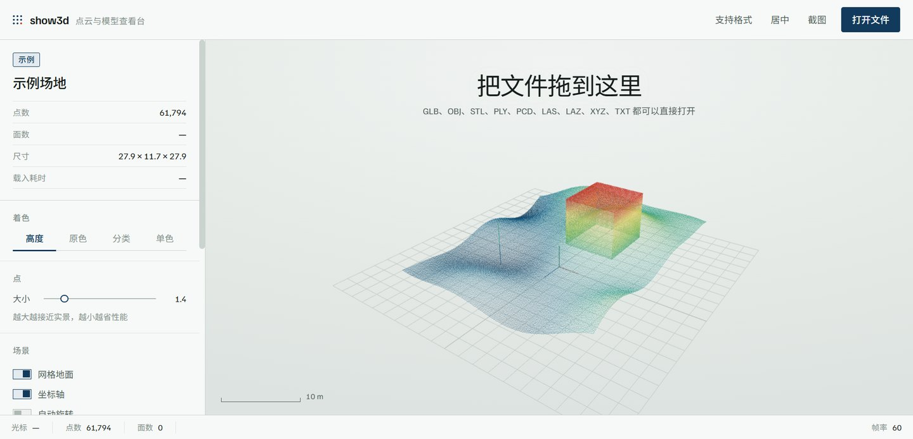

# show3d — 点云与模型查看台

浏览器里直接打开 3D 文件，不上传、不装软件。点云和网格都在同一个视口里看。



```bash
npm install
npm run dev        # http://localhost:5178
```

打开后直接拖文件进视口，或点左侧「示例」。

## 支持格式

| 格式 | 说明 |
|---|---|
| `.glb` `.gltf` | 支持 Draco、KTX2、Meshopt 压缩 |
| `.obj` (+ `.mtl` + 贴图) | 同批次一起拖进来即可 |
| `.stl` | 二进制与 ASCII |
| `.fbx` | 二进制与 ASCII |
| `.ply` | 自动分辨网格、点云、高斯泼溅三种内容；保留 `intensity` 属性 |
| `.pcd` | ASCII / binary |
| `.las` `.laz` | LAS 1.2–1.4，点格式 0–10；LAZ 靠 WASM 解压 |
| `.xyz` `.txt` `.pts` `.csv` | `x y z [r g b]`，逗号或空格分隔 |
| `.jsonl` | 扫描位姿轨迹：`sensor_pose.position` + `yaw_deg` / `pitch_deg` |

明确不支持：`.blend`（浏览器无法可靠解析）、`.dwg`、`.max`、`.skp`、`.e57`。

## 功能

- 拖拽打开，可一次拖多个文件，每个文件一个标签页
- 标签页切换不重新解析；每个标签记住自己的视角、着色和点大小
- 把 `.ply` 和位姿 `.jsonl` 一起拖进来，轨迹会自动叠到点云上（共用同一个原点）
- 着色：按高度色带 / 文件原色 / 分类色 / 强度灰度 / 单色（强度只在文件带 `intensity` 时出现）
- 点大小调节，大量点时自动缩小
- 视口左下角比例尺随缩放变化（LAS 系按米，其它格式只显示数值）
- 底部读数条：光标坐标、点数、面数、帧率
- 双击视口或点「居中」重新取景
- 截图保存为 PNG
- 所有解码在本机浏览器完成，文件不会上传

## 已知限制

- **LAZ 解压是同步的**，`laz-perf` 的逐点接口约 2 µs/点：300 万点约 8 秒，1000 万点约 25 秒。期间有进度提示，界面不会冻结。
- **千万点级别帧率取决于显卡**。没有做 LOD / 八叉树流式加载；再大的数据建议先转 COPC 或切片。
- FBX 只做了加载验证，没有覆盖复杂骨骼动画场景。
- `.e57` 与 CAD 格式（STEP/IFC）尚未接入。

## 结构

```
src/
  main.js              载入管线 + 界面接线
  core/viewer.js       场景、相机取景、着色、比例尺
  core/colors.js       高度色带与分类色板（sRGB→线性转换）
  loaders/registry.js  扩展名 → loader 分发
  loaders/*.js         各格式解析
tools/
  make-samples.mjs     生成 public/samples 下的示例文件
  make-laz.py          scan.las → scan.laz（需要 laspy + lazrs）
  probe-laz.mjs        LAZ 解码耗时剖析
```

## 示例文件

```bash
npm run samples                  # 重新生成 GLB/OBJ/STL/PLY/PCD/LAS/XYZ 示例
python tools/make-laz.py         # 生成 scan.laz，需要 pip install laspy lazrs
```

## 技术备注

- **世界坐标是 Z 轴朝上**（测绘惯例）。LAS/LAZ/PCD/XYZ/PLY/STL 直接按原坐标显示，
  底部读数就是文件里的真实坐标；glTF/OBJ/FBX 是 Y 朝上的，导入时转 90°。
- 顶点色按线性空间写入（three 的颜色管理），否则点云会整体发白。
- 网格材质用 `DoubleSide`：第三方导出的文件绕序经常不一致，靠背面剔除会丢面。
- 场景带一张程序生成的反射环境贴图：glTF 的金属材质没有环境就是一团黑。
- `laz-perf` 的 `LASZip.open()` 必须传入**完整 LAZ 文件**，只给点数据段会抛 C++ 异常。

## 部署

已上线：**https://kit-server.tailb014af.ts.net/show3d/**

静态站点，构建产物用相对路径，放域名根或子路径都能跑。

```bash
bash tools/deploy-gx.sh      # 构建 → 打包 → scp → 解包 → 自检
```

gx 上的容器（文件挂载，更新内容不用重启）：

```bash
docker run -d --name show3d --restart unless-stopped \
  -p 172.17.0.1:18080:80 \
  -v /data/home/kit/Project/show3d/html:/usr/share/nginx/html:ro \
  -v /data/home/kit/Project/show3d/nginx.conf:/etc/nginx/conf.d/default.conf:ro \
  nginx:1.27-alpine
```

只绑定 docker 网桥地址，公网 IP 直连不可达。对外走 Tailscale Funnel：

```bash
docker exec kit-tailscale tailscale funnel --bg \
  --set-path=/show3d http://172.17.0.1:18080/show3d
```

注意 Funnel **会剥掉挂载前缀**，所以目标 URL 里要再写一遍 `/show3d`。
